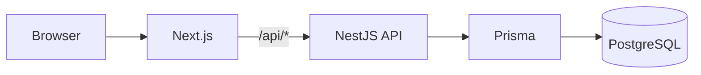

# Nexum Tower

> **SaaS Full Stack de torre de controle logística com IA para monitoramento de viagens, custos, riscos, ocorrências e SLA em tempo real.**

O **Nexum Tower** é uma plataforma web voltada à centralização e acompanhamento de operações logísticas.

A proposta é reunir informações relevantes da operação em uma única aplicação, permitindo acompanhar viagens, custos, riscos, ocorrências e indicadores de SLA dentro de uma arquitetura preparada para evolução de produto SaaS.

<!--
Adicione aqui uma screenshot real da aplicação.

Exemplo:

-->

---

## Overview

O projeto foi desenvolvido como uma aplicação **Full Stack em monorepo**, com separação entre frontend, backend, banco de dados e pacotes compartilhados.

### Core Stack

`Next.js 15` · `TypeScript` · `NestJS` · `PostgreSQL` · `Prisma`

### Engineering Highlights

- Arquitetura monorepo com **pnpm + Turborepo**
- Frontend desenvolvido com **Next.js + TypeScript**
- Backend estruturado com **NestJS**
- Persistência com **PostgreSQL + Prisma**
- Validação de dados com **Zod**
- Autenticação utilizando cookies `httpOnly`
- Comunicação frontend/API através de proxy same-origin
- Estrutura de internacionalização para **PT / EN / ES**
- Documentação dedicada a **RBAC, RLS, auditoria, segurança e feature flags**

---

## Architecture



O frontend utiliza um proxy same-origin:

```text
/api/* → NestJS API
```

Essa estratégia permite trabalhar com autenticação baseada em cookies `httpOnly` sem expor tokens diretamente ao JavaScript do frontend.

---

## Monorepo

```text
nexum-tower/
│
├── apps/
│   ├── web/              # Frontend Next.js
│   └── api/              # Backend NestJS
│
├── packages/
│   ├── database/         # Prisma schema, migrations e client
│   ├── config/           # Configurações compartilhadas
│   ├── ui/               # Componentes compartilhados
│   └── shared/           # Tipos, schemas Zod e helpers
│
├── docs/                 # Documentação técnica
├── .env.example
└── turbo.json
```

O monorepo permite manter frontend e backend separados por responsabilidade enquanto compartilha configurações, tipos e recursos comuns entre as aplicações.

---

## Tech Stack

| Área | Tecnologia |
|---|---|
| **Frontend** | Next.js 15, TypeScript, Tailwind CSS |
| **Backend** | NestJS, TypeScript |
| **Database** | PostgreSQL |
| **ORM** | Prisma |
| **Validation** | Zod |
| **Monorepo** | pnpm, Turborepo |
| **Quality** | ESLint, Prettier |

---

## Internationalization

A aplicação possui estrutura para três idiomas:

- 🇧🇷 Português
- 🇺🇸 English
- 🇪🇸 Español

Rotas:

```text
/pt
/en
/es
```

Mais detalhes:

[Internationalization Documentation](./docs/I18N.md)

---

## Security & Platform

O projeto possui documentação específica para aspectos importantes da arquitetura e segurança:

- [Security Guardrails](./docs/SECURITY-GUARDRAILS.md)
- [Security Checklist](./docs/SECURITY-CHECKLIST.md)
- [Authentication](./docs/AUTHENTICATION.md)
- [RBAC](./docs/RBAC.md)
- [Row Level Security — RLS](./docs/RLS.md)
- [Audit](./docs/AUDIT.md)
- [Feature Flags](./docs/FEATURE-FLAGS.md)
- [Tenant Settings](./docs/SETTINGS.md)

> Consulte o status atual do projeto para verificar o estágio de implementação de cada recurso.

---

## Technical Documentation

Para aprofundar na arquitetura e implementação:

- [Architecture](./docs/ARCHITECTURE.md)
- [API Standards](./docs/API-STANDARDS.md)
- [Authentication](./docs/AUTHENTICATION.md)
- [Security Guardrails](./docs/SECURITY-GUARDRAILS.md)
- [RBAC](./docs/RBAC.md)
- [RLS](./docs/RLS.md)
- [Audit](./docs/AUDIT.md)
- [Feature Flags](./docs/FEATURE-FLAGS.md)
- [Design System](./docs/DESIGN-SYSTEM.md)
- [Internationalization](./docs/I18N.md)
- [Current Status](./docs/STATUS-ATUAL.md)
- [Roadmap](./docs/ROADMAP.md)

---

## Running Locally

### Requirements

- Node.js 20+
- pnpm 9+
- PostgreSQL 18

### Install dependencies

```bash
pnpm install
```

### Environment

Na raiz do projeto:

```powershell
copy .env.example .env
```

Configure a conexão PostgreSQL em:

```env
DATABASE_URL=
```

Para o package de banco:

```powershell
copy packages\database\.env.example packages\database\.env
```

### Database

Depois de configurar o PostgreSQL:

```bash
pnpm db:generate
pnpm db:migrate
pnpm db:seed
```

### Start development

Ambiente completo:

```bash
pnpm dev
```

Ou separadamente:

```bash
pnpm dev:web
pnpm dev:api
```

### Local URLs

| Serviço | URL |
|---|---|
| Frontend | `http://localhost:3000` |
| Português | `http://localhost:3000/pt` |
| English | `http://localhost:3000/en` |
| Español | `http://localhost:3000/es` |
| API Health | `http://localhost:3333/health` |
| Prisma Studio | `http://localhost:5555` |

---

## Development Authentication

Após executar migrations e seed:

```text
Admin
admin@nexumtower.local
admin123
```

Outros perfis de desenvolvimento:

```text
*@nexumtower.local
test123
```

> As credenciais acima são destinadas exclusivamente ao ambiente local de desenvolvimento.

Mais detalhes:

[Authentication Documentation](./docs/AUTHENTICATION.md)

---

## Useful Commands

```bash
pnpm dev          # Inicia ambiente de desenvolvimento
pnpm dev:web      # Inicia frontend
pnpm dev:api      # Inicia backend

pnpm build        # Build do monorepo
pnpm lint         # Executa lint
pnpm format       # Formata o código

pnpm db:generate  # Gera Prisma Client
pnpm db:migrate   # Executa migrations
pnpm db:seed      # Popula banco local
pnpm db:studio    # Abre Prisma Studio
```

---

## Project Status

O Nexum Tower está em evolução contínua.

Para acompanhar o estado atual:

[Current Status →](./docs/STATUS-ATUAL.md)

Próximas etapas:

[Roadmap →](./docs/ROADMAP.md)

---

## Case Study

O Nexum Tower faz parte do meu portfólio de projetos Full Stack.

No case study apresento de forma mais visual:

- contexto do produto;
- arquitetura;
- stack;
- decisões de engenharia;
- estrutura Full Stack;
- principais aspectos técnicos.

<!--
Quando o portfólio estiver publicado, substituir pelo link real:

[Explore Nexum Tower Case Study →](https://SEU-DOMINIO.com/pt/projects/nexum-tower)
-->

---

## Author

### Michele Andrade

**Full Stack Developer**

`React` · `TypeScript` · `Next.js` · `Node.js` · `NestJS` · `SQL`

- [GitHub](https://github.com/michelesilva20)
- [LinkedIn](https://www.linkedin.com/in/michele-andrade-dev)

---

## License

Projeto privado — **Nexum Tower**.
