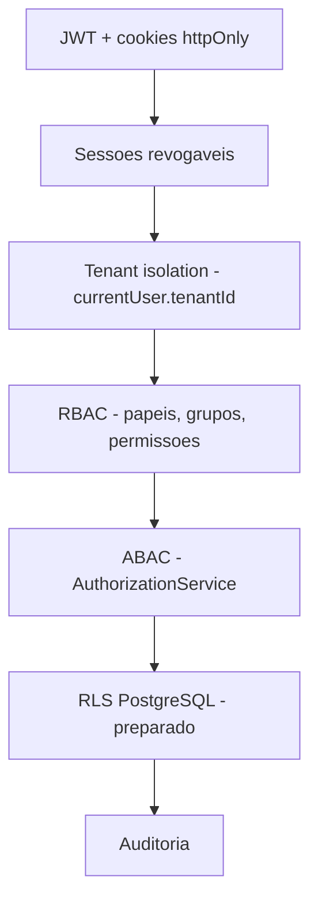

# Estado do projeto — Nexum Tower

Snapshot do projeto **após a entrega Nexum Core Platform Security & Governance** (julho/2026). Use este documento para entender o que já funciona, o que está parcial e o que vem a seguir.

> Para detalhes técnicos por área, consulte os links no final. Documento anterior (mais operacional): [STATUS-ATUAL.md](./STATUS-ATUAL.md).

---

## Em uma frase

O Nexum Tower é uma **plataforma SaaS multi-tenant com fundação de segurança e governança pronta no backend**, landing + área autenticada no frontend, e **sem módulos operacionais de logística** (viagens, frota, custos etc.) — estes são o próximo grande bloco de produto.

---

## O que mudou recentemente

A leva **Security & Governance** consolidou o backend da plataforma antes de construir módulos de negócio:

| Área | Antes | Agora |
|------|-------|-------|
| Resposta da API | JSON “cru” | Envelope padronizado `{ success, data, meta }` (compatível com o frontend via `apiRequest`) |
| Sessões | Login, logout, refresh | + `logout-all`, listar/revogar sessões, cookies alinhados com `REFRESH_TOKEN_EXPIRES_IN` |
| RBAC na API | Somente leitura | CRUD completo de usuários, grupos, papéis, overrides |
| Autorização contextual | Só RBAC | + `AuthorizationService` (ABAC: mesmo tenant, papéis de sistema, último owner) |
| RLS | Inexistente | Policies preparadas (sem `FORCE` — comportamento atual preservado) |
| Settings / features | Inexistente | Catálogo global + valores por tenant na API |
| Auditoria | Listagem simples | Catálogo de ações + filtros + paginação |
| Testes | Zero | Jest na API — 24 testes nos caminhos críticos de segurança |
| Documentação | Parcial | Guardrails, checklist, API standards, RLS, audit, settings, feature flags |

---

## Arquitetura em camadas (segurança)

Nenhuma camada substitui a outra — elas se somam:



O frontend (`PermissionGate`, menu filtrado) **melhora a UX**; a segurança real está na API.

---

## Stack

| Camada | Tecnologia |
|--------|------------|
| Monorepo | pnpm 9 + Turborepo |
| Frontend | Next.js 15, TypeScript, Tailwind, next-intl (pt/en/es) |
| Backend | NestJS 11, Passport JWT, class-validator |
| Banco | PostgreSQL + Prisma 6 |
| Testes API | Jest + ts-jest |

### Estrutura principal

```txt
apps/web/              Landing, login, /app (área autenticada)
apps/api/              REST API NestJS
packages/database/     Schema, migrations, seed
packages/shared/       Zod, permissionMatches, hasAllPermissions
packages/ui/           Utilitários UI compartilhados
docs/                  Documentação canônica
```

### Ambiente local

| Serviço | URL / comando |
|---------|----------------|
| Frontend | http://localhost:3000/pt |
| API | http://localhost:3333 |
| Proxy browser → API | `/api/*` (rewrite Next.js) |
| Subir tudo | `pnpm dev` |
| Migrations | `pnpm db:migrate` ou `pnpm --filter database prisma migrate deploy` |
| Seed | `pnpm db:seed` |
| Prisma Studio | `pnpm db:studio` |
| Testes API | `pnpm --filter api test` |

---

## Backend — o que a API expõe hoje

### Infraestrutura transversal

- **Helmet**, CORS com credentials, **ValidationPipe** (whitelist + forbidNonWhitelisted)
- **ThrottlerGuard** global (login: 8 req/min)
- **GlobalResponseInterceptor** + **GlobalExceptionFilter** + **RequestIdMiddleware** (`x-request-id`)
- Guards globais: JWT (exceto `@Public()`), permissões (`@RequirePermissions`)

### Módulos

| Módulo | Rotas principais | Observação |
|--------|------------------|------------|
| **Auth** | `login`, `refresh`, `logout`, `logout-all`, `me`, `sessions` | JWT em cookie httpOnly; refresh com rotação; hash SHA-256 no banco |
| **Users** | CRUD + status, papéis, grupos, overrides | Soft delete (`DISABLED`); convite sem e-mail → status `INVITED` |
| **Groups** | CRUD + membros + papéis do grupo | |
| **Roles** | CRUD + permissões do papel | Papéis `isSystem` protegidos |
| **Permissions** | `GET /permissions`, `/permissions/modules` | Catálogo global |
| **RBAC (alias)** | `GET /rbac/permissions\|roles\|groups` | Compatibilidade com telas admin atuais |
| **Settings** | `GET/PATCH /settings/:key` | Parâmetros por tenant; sensíveis exigem `settings.security.update` |
| **Features** | `GET /features`, `PATCH /features/tenant/:key` | Feature flags por tenant |
| **Audit** | `GET /audit`, `/audit/logs`, `/audit/:id` | Filtros + paginação opcional |
| **Health** | `GET /health` | |

Contrato de resposta: [API-STANDARDS.md](./API-STANDARDS.md).

---

## Banco de dados

### Migrations aplicadas

1. `20260629195226_init` — Tenant base  
2. `20260630180000_auth_foundation` — Auth + RBAC + Audit  
3. `20260703140000_rls_core_platform` — RLS nas tabelas core (sem FORCE)  
4. `20260703150000_settings_and_features` — Settings + feature flags + RLS tenant-scoped  

### Modelos

**Governança:** `Tenant`, `User`, `Group`, `GroupMember`, `GroupRole`, `Role`, `Permission`, `RolePermission`, `UserRole`, `UserPermissionOverride`, `AuthSession`, `AuditLog`

**Configuração:** `SettingDefinition`, `TenantSetting`, `Feature`, `TenantFeature`

**Ainda não existem** tabelas de negócio (Trip, Shipment, Vehicle, Incident, Cost, etc.).

### Seed (`pnpm db:seed`)

- Tenant demo: **Nexum Demo Logistics** (`nexum-demo`)
- 8 papéis, 6 grupos, 8 usuários de teste, ~70+ permissões (incl. módulos futuros)
- Definições de settings e feature flags (idempotente)

Credenciais: ver [AUTHENTICATION.md](./AUTHENTICATION.md) (senha padrão `test123`, admin `admin123`).

---

## Frontend — o que o usuário vê

### Pronto

- Landing marketing (`/[locale]/`)
- Login com cookies httpOnly (`/[locale]/login`)
- Layout autenticado: sidebar, topbar, design system Nexum
- Telas admin **somente leitura**: usuários, grupos, papéis, permissões, auditoria
- Command Center (`/app`) — **dados demo**, protegido por `dashboard.read`
- i18n pt / en / es
- `PermissionGate` + `/access-denied`

### Parcial / pendente (Etapa 2)

- Formulários de CRUD admin (criar/editar usuário, grupo, papel, overrides)
- Telas de settings, feature flags, gestão de sessões
- Integração das novas APIs (`POST/PATCH/DELETE`) nas telas existentes

### Menu lateral

Módulos operacionais (viagens, mapa, custos, IA…) estão definidos em `navigation.ts` com `comingSoon: true` e **não aparecem** no menu.

---

## Testes automatizados

| Pacote | Ferramenta | Cobertura atual |
|--------|------------|-----------------|
| `apps/api` | Jest | Login, refresh inválido, `PermissionsGuard`, `RbacService` (DENY > ALLOW, wildcards), `AuthorizationService` |
| `apps/web` | — | Nenhum teste E2E ainda |

Comando: `pnpm --filter api test`

---

## Documentação canônica (leitura recomendada)

| Documento | Para quê |
|-----------|----------|
| [SECURITY-GUARDRAILS.md](./SECURITY-GUARDRAILS.md) | Regras não-negociáveis antes de mexer na API |
| [SECURITY-CHECKLIST.md](./SECURITY-CHECKLIST.md) | Checklist de PR |
| [API-STANDARDS.md](./API-STANDARDS.md) | Envelope, erros, paginação |
| [AUTHENTICATION.md](./AUTHENTICATION.md) | Fluxo de login/sessão |
| [RBAC.md](./RBAC.md) | Permissões, CRUD, ABAC |
| [AUDIT.md](./AUDIT.md) | Catálogo e consulta de logs |
| [SETTINGS.md](./SETTINGS.md) / [FEATURE-FLAGS.md](./FEATURE-FLAGS.md) | Parâmetros e toggles por tenant |
| [RLS.md](./RLS.md) | Ativação completa de isolamento no banco |
| [ROADMAP.md](./ROADMAP.md) | Fases do produto |

---

## Limitações conhecidas

| Limitação | Impacto | Próximo passo |
|-----------|---------|---------------|
| RLS sem FORCE + API como owner do banco | Policies existem mas não bloqueiam queries “esquecidas” ainda | Role de baixo privilégio + FORCE ([RLS.md](./RLS.md)) |
| Sem serviço de e-mail | Convite de usuário não envia link | Admin define senha via `PATCH`; e-mail futuro |
| Admin UI só leitura | Backend CRUD pronto, sem forms | Etapa 2 — telas administrativas |
| Command Center mock | KPIs/viagens não são reais | Módulo operacional de viagens |
| `prisma generate` com `pnpm dev` rodando | EPERM no Windows (DLL travada) | Parar dev → `pnpm db:generate` → seed → reiniciar |
| Cache `.next` corrompido | Erro `Cannot find module './285.js'` | `pnpm dev:web:clean` + hard refresh |

---

## Próximos passos sugeridos (ordem)

### Imediato (validar a fundação)

1. Parar `pnpm dev`, rodar `pnpm db:generate` e `pnpm db:seed`
2. Reiniciar e testar login com perfis diferentes (owner, tenant-admin, viewer)
3. Exercitar CRUD via API (Postman/Insomnia): criar usuário `INVITED`, atribuir papel, revogar sessão
4. Rodar `pnpm --filter api test`

### Etapa 2 — Admin UI

- Formulários de usuários, grupos, papéis, overrides
- Telas `/app/settings`, feature flags, sessões ativas
- Consumir endpoints já existentes (backend pronto)

### Etapa 3 — Domínio operacional

- Modelagem Prisma: viagens, cargas, ocorrências, frota, custos
- APIs + telas reais no Command Center
- Substituir mocks por dados do banco

### Produção (quando aplicável)

- MFA/SSO, CI/CD, variáveis de produção (`JWT_*`, `AUTH_COOKIE_*`)
- Usuário PostgreSQL restrito + RLS ativo
- Cobertura de testes ampliada

---

## Mapa visual rápido

```txt
┌──────────────────────────────────────────────────────────────────┐
│  PRONTO                                                          │
│  Monorepo · Landing · Login · Layout /app · Design system        │
│  API padronizada · Auth + sessões · RBAC CRUD · ABAC             │
│  Settings · Feature flags · Auditoria · RLS preparado · Testes     │
│  Telas admin (leitura) · i18n · Seed completo                    │
├──────────────────────────────────────────────────────────────────┤
│  PARCIAL                                                         │
│  Command Center (mock + gate) · Admin UI (sem forms de escrita)  │
├──────────────────────────────────────────────────────────────────┤
│  NÃO INICIADO                                                    │
│  Viagens · Cargas · Ocorrências · Mapa · Financeiro · IA         │
│  Registro self-service · E-mail · MFA · CI/CD · Produção         │
└──────────────────────────────────────────────────────────────────┘
```

---

## Referência cruzada

- Este documento: **visão atual pós-Security & Governance** (jul/2026)
- [STATUS-ATUAL.md](./STATUS-ATUAL.md): inventário detalhado (algumas seções podem estar em atualização)
- [ROADMAP.md](./ROADMAP.md): fases oficiais do produto

*Última atualização: julho/2026*
