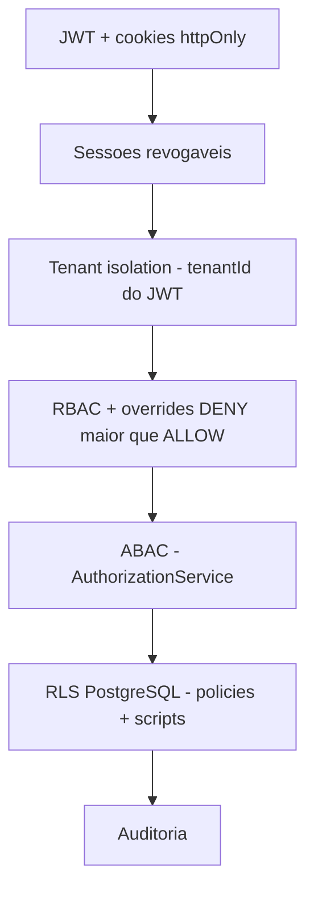

# Onde Estamos — Nexum Tower

> **Snapshot canônico** após a **Finalização 10/10 do Nexum Core Platform**  
> **Data:** julho/2026 · **Decisão:** ✅ **GO** para Nexum Logistics Core

Documentos relacionados (histórico ou detalhe por área):

| Documento | Uso |
|-----------|-----|
| [SITUACAO-ATUAL.md](./SITUACAO-ATUAL.md) | Snapshot anterior (Fundação SaaS — parcialmente desatualizado) |
| [CORE-PLATFORM-COMPLIANCE-REPORT.md](./CORE-PLATFORM-COMPLIANCE-REPORT.md) | Relatório formal de conformidade |
| [GO-NO-GO-LOGISTICS-CORE.md](./GO-NO-GO-LOGISTICS-CORE.md) | Checklist GO/NO-GO |
| [ROADMAP.md](./ROADMAP.md) | Fases oficiais do produto |

---

## Em uma frase

O **Nexum Core Platform está fechado em nível 10/10**: segurança, governança, Admin UI, testes, CI, scripts RLS, regras permanentes para o Cursor e documentação canônica. **Nenhum módulo operacional de logística foi iniciado** — este é o próximo bloco de produto.

---

## Mapa do projeto hoje

```txt
┌──────────────────────────────────────────────────────────────────────┐
│  ✅ CONCLUÍDO — Nexum Core Platform (10/10)                           │
│  Auth · Sessões · RBAC · ABAC · Admin UI · Settings · Feature Flags    │
│  Audit · Security Console · PermissionGate · API padronizada           │
│  61 testes unitários · Playwright E2E · CI com PostgreSQL              │
│  Scripts RLS (nexum_app / nexum_migrator) · Cursor Rules               │
├──────────────────────────────────────────────────────────────────────┤
│  ⚠️ CONTROLADO (não bloqueia GO)                                      │
│  Command Center — KPIs/viagens ainda são demo estáticos                │
│  RLS FORCE — script pronto; não ativo em dev (owner postgres)          │
│  MFA · SSO · e-mail de convite — roadmap futuro                        │
├──────────────────────────────────────────────────────────────────────┤
│  ❌ NÃO INICIADO — Nexum Logistics Core                                │
│  Clientes · Motoristas · Veículos · Rotas · Viagens · Cargas           │
│  Ocorrências · Custos · Documentos · Mapa · IA operacional             │
└──────────────────────────────────────────────────────────────────────┘
```

---

## Validação técnica (última execução)

| Verificação | Resultado |
|-------------|-----------|
| `pnpm typecheck` | ✅ 0 erros (api + web) |
| `pnpm lint` | ✅ Passou |
| `pnpm test:api` | ✅ **61/61** (10 suites) |
| `pnpm build` | ✅ Passou |
| `pnpm dev` | ✅ Frontend + API |
| Playwright E2E | ✅ Configurado (`tests/e2e/`) |
| CI GitHub Actions | ✅ `validate` + `e2e` (main) |

---

## O que existe e funciona

### Backend (NestJS)

| Módulo | Capacidades |
|--------|-------------|
| **Auth** | Login, refresh, logout, logout-all, sessões |
| **Users** | CRUD, status, roles, grupos, overrides ALLOW/DENY |
| **Groups / Roles** | CRUD, vínculos, proteção `isSystem` |
| **Permissions** | Catálogo global (seed) |
| **Settings** | Parâmetros por tenant, tipos, sensíveis |
| **Features** | Feature flags por tenant |
| **Audit** | Catálogo, filtros, paginação |
| **Authorization** | ABAC: `assertSameTenant`, `canManageUser`, `canModifyRole` |
| **Infra** | Helmet, CORS, Throttler, envelope padrão, request-id |

### Frontend (Next.js)

| Rota | Função |
|------|--------|
| `/app` | Command Center (demo + gate `dashboard.read`) |
| `/app/admin/users\|groups\|roles\|permissions\|audit` | Admin UI completo |
| `/app/settings` | Hub de configurações |
| `/app/settings/security` | Security Console |
| `/app/settings/parameters` | Parâmetros editáveis |
| `/app/settings/features` | Feature flags |
| `/app/security/sessions` | Sessões ativas |
| `/access-denied` | Acesso negado |

Gates: `PermissionGate`, `AnyPermissionGate`, `FeatureGate`, `RoleGate` · Sidebar filtrada por permissão.

### Segurança em camadas



Frontend esconde por UX · **API é a fonte real de segurança**.

---

## RLS — onde estamos

| Item | Status |
|------|--------|
| Policies RLS nas tabelas core | ✅ Ativas (migrations) |
| `runWithTenant` | ✅ `packages/database/src/tenant-context.ts` |
| Scripts SQL | ✅ `packages/database/sql/security/` (01–05) |
| Usuário `nexum_app` | 📋 Script pronto; dev ainda usa `postgres` |
| FORCE RLS | 📋 Script `04-force-rls-core.sql` — aplicar em staging/prod |
| Teste manual | `pnpm security:rls:test` |

Detalhes: [RLS-HARDENING.md](./RLS-HARDENING.md)

---

## Testes

| Tipo | Quantidade | Onde |
|------|------------|------|
| Unitários API | **61** | `apps/api/src/**/*.spec.ts` |
| E2E Playwright | **8 fluxos** | `tests/e2e/core-platform.spec.ts` |

Cobertura principal: auth, sessions, RBAC, ABAC, tenant isolation, settings, features, audit, runWithTenant, login admin/viewer, access denied.

Comandos:

```bash
pnpm test:api
pnpm test:e2e          # 1ª vez: pnpm exec playwright install chromium
pnpm security:rls:test # requer nexum_app configurado
```

Detalhes: [TESTING.md](./TESTING.md) · [E2E-TESTING.md](./E2E-TESTING.md)

---

## CI/CD

Pipeline em `.github/workflows/ci.yml`:

1. **validate** — postgres → migrate → seed → lint → typecheck → 61 testes → build  
2. **e2e** — Playwright (push em `main`)

Detalhes: [CI-CD.md](./CI-CD.md)

---

## Regras permanentes para evolução

Antes de qualquer módulo novo, consultar:

1. [CURSOR-CORE-PLATFORM-RULES.md](./CURSOR-CORE-PLATFORM-RULES.md) — regras completas  
2. [SECURITY-GUARDRAILS.md](./SECURITY-GUARDRAILS.md) — guardrails não-negociáveis  
3. [SECURITY-CHECKLIST.md](./SECURITY-CHECKLIST.md) — checklist de PR  
4. `.cursor/rules/nexum-core-platform.mdc` — regra automática no Cursor  

---

## Ambiente local

| Serviço | URL / comando |
|---------|---------------|
| Frontend | http://localhost:3000/pt |
| API | http://localhost:3333 |
| Subir tudo | `pnpm dev` |
| Migrations | `pnpm db:migrate` |
| Seed | `pnpm db:seed` |

### Credenciais de teste (seed)

| Perfil | E-mail | Senha |
|--------|--------|-------|
| Owner | `admin@nexumtower.local` | `admin123` |
| Viewer | `visualizador@nexumtower.local` | `test123` |
| Tenant Admin | `tenantadmin@nexumtower.local` | `test123` |

Mais perfis: [AUTHENTICATION.md](./AUTHENTICATION.md)

---

## O que NÃO existe ainda

Nenhuma entidade operacional no banco ou na API:

```txt
Trip · Shipment · Vehicle · Driver · Route · Incident · Cost · Document
Portal do cliente · Portal do motorista · Dashboard operacional real · Mapa · IA operacional
```

Itens de menu operacionais no sidebar estão marcados como `comingSoon: true` e **não aparecem**.

---

## Pendências aceitas (não bloqueiam GO)

| Pendência | Quando resolver |
|-----------|-----------------|
| FORCE RLS + `nexum_app` em runtime | Antes de produção |
| Command Center com dados reais | Com Logistics Core |
| MFA / SSO / convite por e-mail | Fase enterprise |
| `requestId` persistido em AuditLog | Melhoria futura |

---

## Próximo passo recomendado

### Iniciar Nexum Logistics Core

Ordem sugerida:

1. Ler [GO-NO-GO-LOGISTICS-CORE.md](./GO-NO-GO-LOGISTICS-CORE.md) e [CURSOR-CORE-PLATFORM-RULES.md](./CURSOR-CORE-PLATFORM-RULES.md)  
2. Modelar Prisma: viagens, cargas, ocorrências (sempre com `tenantId`)  
3. Criar policies RLS para novas tabelas (script 03 como referência)  
4. APIs com guards + ABAC + audit log  
5. Atualizar seed de permissões  
6. Telas com PermissionGate + design system Nexum  
7. Testes unitários + E2E por fluxo crítico  

---

## Estrutura alvo vs. realidade

```txt
Nexum Core Platform          ✅ FECHADO (10/10)
├── Auth Core                ✅
├── Session Core             ✅
├── Access Control Core      ✅
├── Admin UI                 ✅
├── Security Console         ✅
├── Settings + Feature Flags ✅
├── Audit Core               ✅
├── API Governance           ✅
├── RLS Hardening            ⚠️ scripts + docs (FORCE em prod)
├── Tests (61 + E2E)         ✅
├── CI/CD                    ✅
├── Cursor Rules             ✅
└── Documentação             ✅

Nexum Logistics Core         ❌ PRÓXIMO PASSO
└── viagens, frota, custos, mapa, IA...
```

---

## Documentação canônica (índice rápido)

| Área | Documento |
|------|-----------|
| Regras Cursor | [CURSOR-CORE-PLATFORM-RULES.md](./CURSOR-CORE-PLATFORM-RULES.md) |
| Conformidade | [CORE-PLATFORM-COMPLIANCE-REPORT.md](./CORE-PLATFORM-COMPLIANCE-REPORT.md) |
| Admin UI | [ADMIN-UI.md](./ADMIN-UI.md) |
| RBAC / ABAC | [RBAC.md](./RBAC.md) |
| RLS | [RLS.md](./RLS.md) · [RLS-HARDENING.md](./RLS-HARDENING.md) |
| Settings / Features | [SETTINGS.md](./SETTINGS.md) · [FEATURE-FLAGS.md](./FEATURE-FLAGS.md) |
| Auditoria | [AUDIT.md](./AUDIT.md) |
| Testes | [TESTING.md](./TESTING.md) · [E2E-TESTING.md](./E2E-TESTING.md) |
| CI | [CI-CD.md](./CI-CD.md) |
| Roadmap | [ROADMAP.md](./ROADMAP.md) |

---

*Última atualização: julho/2026 — pós-Finalização 10/10 Nexum Core Platform*
