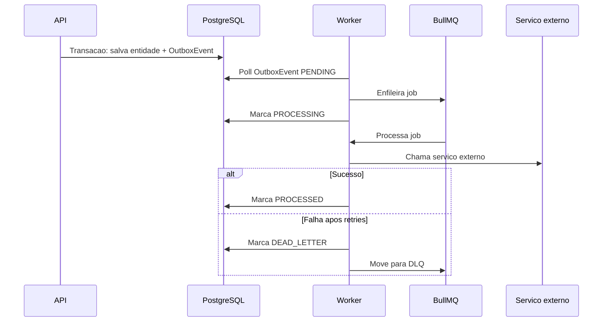

# Nexum Tower — Outbox Pattern

## Objetivo

O Outbox Pattern evita perda de eventos quando uma operação no banco precisa disparar um processamento assíncrono.

---

## Problema

Exemplo perigoso:

1. API cria uma ocorrência.
2. Banco salva a ocorrência.
3. Sistema tenta enviar notificação.
4. A notificação falha.
5. O evento se perde.

---

## Solução

Salvar o evento em uma tabela de outbox **na mesma transação** da operação principal.

Exemplo:

1. API cria uma ocorrência.
2. Banco salva a ocorrência.
3. Banco salva `OutboxEvent`: `incident.created`.
4. Worker lê `OutboxEvent`.
5. Worker envia notificação.
6. Worker marca evento como processado.

---

## Quando usar Outbox

Usar Outbox quando:

- uma ação no banco precisa gerar evento;
- o evento é importante;
- o evento será processado fora da transação principal;
- existe integração externa;
- existe notificação;
- existe webhook;
- existe atualização assíncrona de indicador.

---

## Modelo futuro sugerido

> **Não implementado ainda.** Modelo de referência para quando o primeiro fluxo assíncrono for criado.

```prisma
enum OutboxEventStatus {
  PENDING
  PROCESSING
  PROCESSED
  FAILED
  DEAD_LETTER
}

model OutboxEvent {
  id          String            @id @default(cuid())
  tenantId    String
  type        String
  entity      String?
  entityId    String?
  payload     Json
  metadata    Json?
  status      OutboxEventStatus @default(PENDING)
  attempts    Int               @default(0)
  nextRunAt   DateTime?
  processedAt DateTime?
  failedAt    DateTime?
  error       String?
  createdAt   DateTime          @default(now())
  updatedAt   DateTime          @updatedAt

  @@index([tenantId])
  @@index([status])
  @@index([type])
  @@index([nextRunAt])
}
```

---

## Regras obrigatórias

- `OutboxEvent` deve ter `tenantId`.
- `OutboxEvent` deve avaliar RLS (policy por tenant).
- Payload **não** deve conter secrets.
- Evento deve ser **idempotente** (ver [JOB-IDEMPOTENCY.md](./JOB-IDEMPOTENCY.md)).
- Processamento deve gerar audit log quando crítico.
- Falhas recorrentes devem ir para **DLQ** (ver [DLQ.md](./DLQ.md)).

---

## Fluxo recomendado



---

## Documentos relacionados

- [ASYNC-JOBS.md](./ASYNC-JOBS.md)
- [DLQ.md](./DLQ.md)
- [JOB-IDEMPOTENCY.md](./JOB-IDEMPOTENCY.md)
- [JOB-SECURITY.md](./JOB-SECURITY.md)
