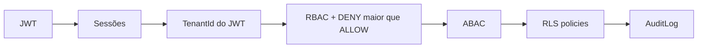

# Panorama Atual — Nexum Tower

> **Documento de referência mais recente** · julho/2026  
> **Decisão:** ✅ **GO** para Nexum Logistics Core  
> **Core Platform:** 10/10 · **Async/DLQ:** preparado (documentado, sem infra ativa)

Documentos anteriores (histórico):

| Documento | Observação |
|-----------|------------|
| [ONDE-ESTAMOS.md](./ONDE-ESTAMOS.md) | Snapshot pós-10/10 — não inclui camada DLQ |
| [SITUACAO-ATUAL.md](./SITUACAO-ATUAL.md) | Fundação SaaS — desatualizado |
| [ESTADO-DO-PROJETO.md](./ESTADO-DO-PROJETO.md) / [STATUS-ATUAL.md](./STATUS-ATUAL.md) | Histórico |

---

## Em uma frase

O Nexum Tower tem **fundação SaaS completa e auditável** (Auth, RBAC, ABAC, RLS, Admin UI, CI, 61 testes, E2E), **regras permanentes para o Cursor**, e agora também o **padrão de jobs assíncronos e DLQ documentado** para fluxos futuros — **sem Redis/BullMQ ativos** e **sem módulos operacionais de logística**.

---

## Visão geral em camadas

```txt
┌─────────────────────────────────────────────────────────────────────────┐
│  ✅ NEXUM CORE PLATFORM — FECHADO (10/10)                                │
│  Auth · Sessões · RBAC · ABAC · Tenant isolation · Audit                 │
│  Settings · Feature Flags · API padronizada · Admin UI · Security Console │
│  61 testes · Playwright E2E · CI (PostgreSQL + migrate + seed + build)   │
│  RLS policies + scripts SQL · Cursor Rules · Compliance GO               │
├─────────────────────────────────────────────────────────────────────────┤
│  📋 ASYNC / DLQ — PREPARADO (só documentação)                            │
│  ASYNC-JOBS · DLQ · Outbox · Idempotency · Observability · Job Security  │
│  Checklist em SECURITY-CHECKLIST · Regras no Cursor                      │
│  Pasta apps/api/src/modules/jobs/ (README only)                          │
│  Redis · BullMQ · workers · OutboxEvent — NÃO implementados              │
├─────────────────────────────────────────────────────────────────────────┤
│  ⚠️ PARCIAL / DEMO                                                       │
│  Command Center (/app) — KPIs e viagens fake                             │
│  RLS FORCE + nexum_app em runtime — scripts prontos, dev usa postgres     │
├─────────────────────────────────────────────────────────────────────────┤
│  ❌ NEXUM LOGISTICS CORE — NÃO INICIADO                                  │
│  Clientes · Motoristas · Veículos · Rotas · Viagens · Ocorrências        │
│  Custos · Documentos · Mapa · IA operacional · Portais                   │
└─────────────────────────────────────────────────────────────────────────┘
```

---

## Validação técnica

| Verificação | Status |
|-------------|--------|
| `pnpm typecheck` | ✅ |
| `pnpm lint` | ✅ |
| `pnpm test:api` | ✅ **61/61** (10 suites) |
| `pnpm build` | ✅ |
| `pnpm dev` | ✅ |
| Playwright E2E | ✅ 8 fluxos (`tests/e2e/`) |
| CI GitHub Actions | ✅ `validate` + `e2e` (main) |

---

## O que funciona hoje

### Backend

Login, refresh, logout, sessões revogáveis, CRUD admin (users/groups/roles), overrides ALLOW/DENY, settings por tenant, feature flags, auditoria, ABAC, envelope API padrão, rate limit, Helmet.

### Frontend

Landing, login, layout `/app`, Admin UI completo, Settings Hub, Security Console, sessões, PermissionGate, sidebar por permissão, `/access-denied`, i18n pt/en/es.

### Segurança



### Ambiente local

| Item | Valor |
|------|-------|
| Frontend | http://localhost:3000/pt |
| API | http://localhost:3333 |
| Subir | `pnpm dev` |
| Seed | `pnpm db:seed` |

**Credenciais:** `admin@nexumtower.local` / `admin123` · `visualizador@nexumtower.local` / `test123`

---

## Documentação (37 arquivos em `docs/`)

### Essencial antes de codar

| Documento | Para quê |
|-----------|----------|
| [CURSOR-CORE-PLATFORM-RULES.md](./CURSOR-CORE-PLATFORM-RULES.md) | Regras obrigatórias do Cursor |
| [SECURITY-GUARDRAILS.md](./SECURITY-GUARDRAILS.md) | Guardrails não-negociáveis |
| [SECURITY-CHECKLIST.md](./SECURITY-CHECKLIST.md) | Checklist de PR (+ Async/DLQ) |
| [GO-NO-GO-LOGISTICS-CORE.md](./GO-NO-GO-LOGISTICS-CORE.md) | GO confirmado + checklist operacional |

### Core Platform

| Documento | Tema |
|-----------|------|
| [ONDE-ESTAMOS.md](./ONDE-ESTAMOS.md) | Snapshot anterior |
| [CORE-PLATFORM-COMPLIANCE-REPORT.md](./CORE-PLATFORM-COMPLIANCE-REPORT.md) | Conformidade formal |
| [ADMIN-UI.md](./ADMIN-UI.md) | Telas admin |
| [RBAC.md](./RBAC.md) · [RLS-HARDENING.md](./RLS-HARDENING.md) | Autorização e isolamento |
| [TESTING.md](./TESTING.md) · [E2E-TESTING.md](./E2E-TESTING.md) · [CI-CD.md](./CI-CD.md) | Qualidade |
| [ROADMAP.md](./ROADMAP.md) | Fases do produto |

### Async / DLQ (preparado — ler antes de jobs futuros)

| Documento | Tema |
|-----------|------|
| [ASYNC-JOBS.md](./ASYNC-JOBS.md) | Quando usar jobs |
| [DLQ.md](./DLQ.md) | Dead Letter Queue |
| [OUTBOX-PATTERN.md](./OUTBOX-PATTERN.md) | Outbox transacional |
| [JOB-IDEMPOTENCY.md](./JOB-IDEMPOTENCY.md) | Idempotência |
| [JOB-OBSERVABILITY.md](./JOB-OBSERVABILITY.md) | Rastreabilidade |
| [JOB-SECURITY.md](./JOB-SECURITY.md) | Segurança de jobs |

Código preparatório: `apps/api/src/modules/jobs/` (somente README + `job-patterns.md`).

---

## RLS — status

| Item | Status |
|------|--------|
| Policies nas tabelas core | ✅ |
| `runWithTenant` | ✅ |
| Scripts `packages/database/sql/security/` | ✅ |
| Teste manual | `pnpm security:rls:test` |
| FORCE RLS + `nexum_app` em dev | ❌ (aplicar em staging/prod) |

---

## Async / DLQ — status

| Item | Status |
|------|--------|
| Documentação completa | ✅ |
| Regras no Cursor + checklist | ✅ |
| Redis / BullMQ | ❌ não instalado |
| Workers / filas ativas | ❌ |
| `OutboxEvent` no Prisma | ❌ |
| `/app/admin/jobs` · `/app/admin/dlq` | ❌ |

**Gatilho para infra ativa:** primeiro fluxo real (e-mail de convite, webhook, notificação operacional, etc.).

---

## O que NÃO existe

Nenhuma entidade operacional no banco ou API:

```txt
Trip · Shipment · Vehicle · Driver · Customer · Route · Incident · Cost · Document
Mapa · tracking · geofence · Risk Score · webhooks · IA operacional
```

Itens de menu operacionais: `comingSoon: true` — não aparecem no sidebar.

---

## Pendências aceitas

| Pendência | Quando |
|-----------|--------|
| Command Center com dados reais | Com Logistics Core |
| FORCE RLS + `nexum_app` | Antes de produção |
| Infra Redis/BullMQ/DLQ | Primeiro job assíncrono real |
| MFA / SSO / e-mail convite | Roadmap futuro |

---

## Próximo passo

### 1. Iniciar Nexum Logistics Core (cadastros mestres)

Pode começar **sem** Redis/BullMQ — cadastros síncronos (clientes, motoristas, veículos) seguem o Core Platform.

Checklist: [GO-NO-GO-LOGISTICS-CORE.md](./GO-NO-GO-LOGISTICS-CORE.md) + [CURSOR-CORE-PLATFORM-RULES.md](./CURSOR-CORE-PLATFORM-RULES.md).

### 2. Quando surgir fluxo assíncrono

Antes de implementar: ler [ASYNC-JOBS.md](./ASYNC-JOBS.md) e [DLQ.md](./DLQ.md).

Ordem sugerida: OutboxEvent → Redis/BullMQ → workers → DLQ → audit → telas admin.

---

## Comandos úteis

```bash
pnpm dev                 # frontend + API
pnpm db:seed             # usuários de teste
pnpm test:api            # 61 testes
pnpm test:e2e            # Playwright
pnpm typecheck && pnpm lint && pnpm build
pnpm security:rls:test   # RLS manual (nexum_app)
```

---

## Linha do tempo recente

| Etapa | Status |
|-------|--------|
| Fundação SaaS (Auth, RBAC, layout) | ✅ |
| Admin UI + Security Console + CI | ✅ |
| Finalização 10/10 Core Platform | ✅ |
| Padrão Async/DLQ documentado | ✅ |
| Nexum Logistics Core | ⏭️ **próximo** |

---

*Última atualização: julho/2026 — inclui Core 10/10 + preparação DLQ/Async*
