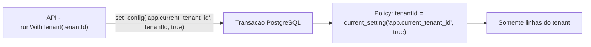

# Row Level Security (RLS) — Nexum Tower

Camada final de isolamento multi-tenant: mesmo que uma query esqueça o filtro `tenantId`, o PostgreSQL bloqueia linhas de outros tenants.

> Estado atual: **preparado**, não totalmente ativado. As policies existem e são testáveis, mas `FORCE ROW LEVEL SECURITY` e o usuário de banco de baixo privilégio ainda **não** foram habilitados (decisão consciente para não alterar o comportamento em desenvolvimento).

## 1. Como funciona



- A aplicação define o contexto com `set_config('app.current_tenant_id', <id>, true)` (escopo de transação).
- As policies comparam `"tenantId"` com esse contexto.
- Helper: `runWithTenant()` em `packages/database/src/tenant-context.ts`.

## 2. Tabelas com policy de isolamento

Migration `20260703140000_rls_core_platform`:

- `User`, `Group`, `GroupMember`, `UserRole`, `GroupRole`, `UserPermissionOverride`, `AuthSession`, `AuditLog`

Migration de settings/features adiciona:

- `TenantSetting`, `TenantFeature`

### Tabelas sem RLS (e motivo)

| Tabela | Motivo |
|--------|--------|
| `Tenant` | Raiz do isolamento; acesso controlado na aplicação |
| `Permission` | Catálogo global (sem `tenantId`) |
| `RolePermission` | Ligação role↔permission (sem `tenantId`) |
| `Role` | `tenantId` nullable (papéis podem ser globais); isolamento na aplicação |
| `SettingDefinition`, `Feature` | Catálogos globais (sem `tenantId`) |

## 3. Por que ainda não bloqueia em dev

O dono de uma tabela no PostgreSQL **ignora** RLS por padrão. A API hoje conecta como dono/superusuário, então as policies não filtram nada — o comportamento atual é preservado. O bloqueio real exige uma das duas condições abaixo.

## 4. Ativação completa (produção) — passo a passo

### 4.1 Criar usuário de banco de baixo privilégio

```sql
CREATE ROLE nexum_app LOGIN PASSWORD 'senha-forte';
GRANT CONNECT ON DATABASE nexum_tower TO nexum_app;
GRANT USAGE ON SCHEMA public TO nexum_app;
GRANT SELECT, INSERT, UPDATE, DELETE ON ALL TABLES IN SCHEMA public TO nexum_app;
GRANT USAGE, SELECT ON ALL SEQUENCES IN SCHEMA public TO nexum_app;
ALTER DEFAULT PRIVILEGES IN SCHEMA public
  GRANT SELECT, INSERT, UPDATE, DELETE ON TABLES TO nexum_app;
-- NUNCA conceder BYPASSRLS a este usuário.
```

Aponte a `DATABASE_URL` da API para `nexum_app`. Mantenha um usuário owner separado só para migrations/seed.

### 4.2 (Opcional) FORCE RLS

Para bloquear também o dono da tabela:

```sql
ALTER TABLE "User" FORCE ROW LEVEL SECURITY;
-- repita para as demais tabelas com policy
```

### 4.3 Sempre usar runWithTenant

Com RLS ativo, queries fora de `runWithTenant` (sem contexto) retornam vazio. Toda operação tenant-aware deve rodar dentro do helper.

## 5. Testar isolamento

Script pronto: `packages/database/prisma/rls-test.sql`.

```bash
psql "$DATABASE_URL" -f packages/database/prisma/rls-test.sql
```

Cenários validados:

1. Sem contexto → 0 linhas (com FORCE/usuário restrito).
2. Tenant A no contexto → só dados de A.
3. Tenant B no contexto → dados de A invisíveis.

## 6. Checklist para novas tabelas tenant-aware

- [ ] Coluna `tenantId` NOT NULL + índice
- [ ] `ENABLE ROW LEVEL SECURITY` + policy `USING`/`WITH CHECK`
- [ ] Query sempre via `runWithTenant` ou filtrando `currentUser.tenantId`
- [ ] Teste de isolamento adicionado

Ver também [SECURITY-GUARDRAILS.md](./SECURITY-GUARDRAILS.md).
