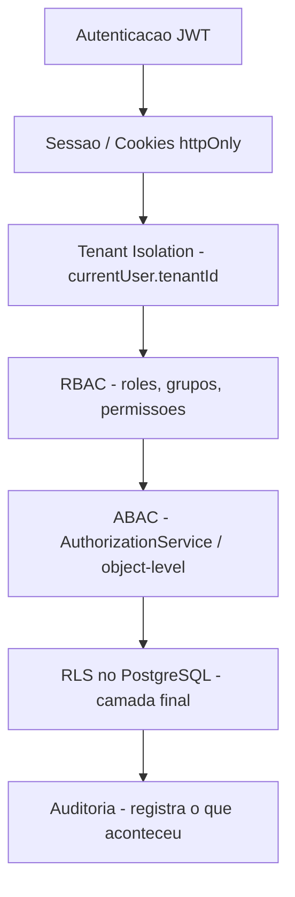

# Security Guardrails — Nexum Core Platform

> **Antes de qualquer nova implementação, consulte também:**
>
> - [CURSOR-CORE-PLATFORM-RULES.md](./CURSOR-CORE-PLATFORM-RULES.md)
> - [SECURITY-CHECKLIST.md](./SECURITY-CHECKLIST.md)
>
> Estes documentos são obrigatórios para manter as camadas de segurança do Nexum Tower.

> **Leitura obrigatória** antes de criar qualquer endpoint, model ou tela que lide com dados de tenant. Estas são as regras não-negociáveis da plataforma.

## Camadas de segurança

Nenhuma camada substitui a outra — elas se somam (defense in depth):



O frontend (`PermissionGate`, menu filtrado) é **apenas UX** — nunca é fronteira de segurança.

## Regras não-negociáveis

### 1. Tenant isolation
- **NUNCA** aceitar `tenantId` do frontend (body, query, params). Sempre `currentUser.tenantId` (do JWT).
- Toda query tenant-aware filtra por `tenantId`.
- Ao receber o id de um objeto, validar que pertence ao tenant (retornar 404, não 403, para não vazar existência).

### 2. Autenticação e sessão
- Access token JWT curto em cookie `httpOnly` (`nexum_access`); refresh com rotação em cookie `httpOnly` (`nexum_refresh`).
- Refresh token armazenado como **hash SHA-256** — nunca em texto puro; nunca exposto em respostas.
- Senhas com `bcrypt` (custo 12).
- Logout revoga a sessão; `logout-all` revoga todas.

### 3. Autorização (RBAC + ABAC)
- Todo endpoint protegido com `@RequirePermissions(...)` (ou `@Public()` explícito).
- Precedência de permissões: **DENY sempre prevalece** sobre ALLOW (ver [RBAC.md](./RBAC.md)).
- Papéis `isSystem` não podem ser editados/removidos (`AuthorizationService.assertCanModifyRole`).
- Proteção de "último owner": não é possível desativar/remover o último owner ativo do tenant.

### 4. Entrada de dados
- Todo body usa DTO com `class-validator`.
- `ValidationPipe` com `whitelist` + `forbidNonWhitelisted` → campos não declarados são rejeitados (sem mass assignment).

### 5. Respostas e erros
- Envelope padronizado (`{ success, data, meta }` / `{ success:false, error }`) — ver [API-STANDARDS.md](./API-STANDARDS.md).
- Sem stack trace em produção.

### 6. Auditoria
- Ações sensíveis auditadas com o catálogo `AuditAction` (ver [AUDIT.md](./AUDIT.md)).
- Nunca logar segredos.

### 7. RLS
- Novas tabelas tenant-aware nascem com `tenantId` NOT NULL + RLS policy (ver [RLS.md](./RLS.md)).

## Anti-padrões proibidos

| ❌ Não faça | ✅ Faça |
|------------|---------|
| `where: { id }` sem `tenantId` | `where: { id, tenantId: user.tenantId }` |
| `tenantId` vindo do body | `currentUser.tenantId` |
| Endpoint sem `@RequirePermissions` | Permissão explícita ou `@Public()` |
| Confiar no menu filtrado como segurança | Guard no backend |
| Retornar `error.stack` ao cliente | `GlobalExceptionFilter` |
| Hard delete de usuário | Soft delete (`status = DISABLED`) |

## Onde cada guardrail vive no código

- Auth/sessão: `apps/api/src/modules/auth/`
- RBAC: `apps/api/src/modules/rbac/`, `guards/permissions.guard.ts`
- ABAC: `apps/api/src/modules/authorization/authorization.service.ts`
- Padrão de resposta/erro/requestId: `apps/api/src/common/`
- RLS: `packages/database/prisma/migrations/*_rls_*`, `packages/database/src/tenant-context.ts`
- Auditoria: `apps/api/src/modules/audit/`, `apps/api/src/common/audit-actions.ts`

Use o [SECURITY-CHECKLIST.md](./SECURITY-CHECKLIST.md) em todo PR.

---

## Async Jobs e DLQ

Funcionalidades assíncronas críticas devem seguir os documentos:

- [ASYNC-JOBS.md](./ASYNC-JOBS.md)
- [DLQ.md](./DLQ.md)
- [OUTBOX-PATTERN.md](./OUTBOX-PATTERN.md)
- [JOB-IDEMPOTENCY.md](./JOB-IDEMPOTENCY.md)
- [JOB-OBSERVABILITY.md](./JOB-OBSERVABILITY.md)
- [JOB-SECURITY.md](./JOB-SECURITY.md)

A regra é:

> Se uma ação crítica sai do fluxo síncrono da API, ela precisa avaliar fila, retry, DLQ, idempotência, auditoria e observabilidade.

A infraestrutura ativa (Redis/BullMQ) **não está instalada** — padrão documentado para implementação no primeiro fluxo assíncrono real.

---

## ⚠️ ANTES DE CRIAR QUALQUER MÓDULO OPERACIONAL

> Antes de iniciar `trips`, `customers`, `drivers`, `vehicles`, `routes`, `incidents`,
> `costs`, `documents` ou qualquer outro módulo operacional, confirme que:

```text
[ ] A fundação SaaS está completa (ver docs/ESTADO-DO-PROJETO.md)
[ ] O Admin UI permite gerenciar usuários, grupos e roles (ver docs/ADMIN-UI.md)
[ ] O RLS está ativo nas tabelas core (ver docs/RLS-HARDENING.md)
[ ] Os 50 testes unitários passam (ver docs/TESTING.md)
[ ] O CI está configurado e passando (ver docs/CI-CD.md)
[ ] Cada nova tabela com tenantId segue o checklist de RLS
[ ] Cada novo endpoint usa AuthorizationService.assertSameTenant ou runWithTenant
[ ] Cada ação sensível gera audit log via AuditService
[ ] Toda resposta usa o envelope padrão (GlobalResponseInterceptor)
[ ] Erros retornam o formato padrão (GlobalExceptionFilter)
```
