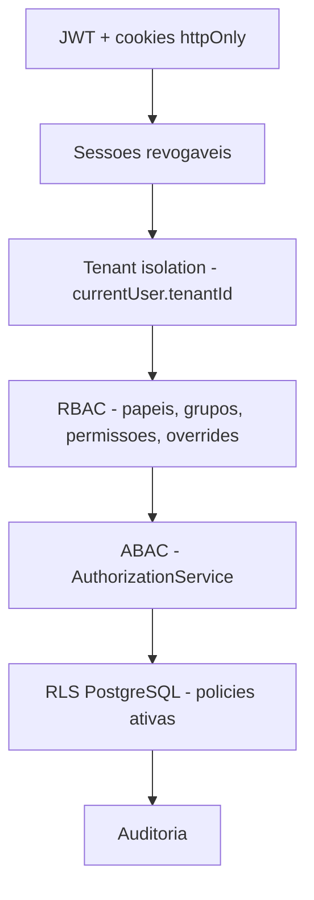

# Situação Atual — Nexum Tower

Documento de referência **atualizado após o fechamento da Fundação SaaS** (Admin UI + Security Console + RLS Hardening + Testes + CI).

> **Data:** julho/2026 · **Ambiente:** desenvolvimento local (Windows)  
> Documentos anteriores (parcialmente desatualizados): [ESTADO-DO-PROJETO.md](./ESTADO-DO-PROJETO.md), [STATUS-ATUAL.md](./STATUS-ATUAL.md)

---

## Em uma frase

O Nexum Tower é uma **plataforma SaaS multi-tenant com fundação de segurança, governança e Admin UI completos** — pronta para receber os módulos operacionais de logística (viagens, frota, custos, mapa, etc.), que **ainda não foram iniciados**.

---

## Mapa visual do projeto

```txt
┌─────────────────────────────────────────────────────────────────────┐
│  ✅ PRONTO — Nexum Core Platform                                     │
│  Monorepo · Landing · Login · Layout /app · Design system Nexum      │
│  Auth (JWT + refresh + sessões revogáveis) · RBAC + ABAC             │
│  Admin UI completo (users/groups/roles/permissions/audit)            │
│  Settings · Feature flags · Sessões · Security Console               │
│  PermissionGate · Menus por permissão · Access denied                │
│  API padronizada · Auditoria · RLS preparado · 50 testes · CI        │
├─────────────────────────────────────────────────────────────────────┤
│  ⚠️ PARCIAL / PREPARADO                                              │
│  Command Center (/app) — dados demo, gate dashboard.read             │
│  RLS — policies ativas, FORCE RLS e usuário nexum_app documentados   │
│  Playwright E2E — estrutura documentada, não instalado               │
│  MFA · SSO · e-mail de convite — não implementados                   │
├─────────────────────────────────────────────────────────────────────┤
│  ❌ NÃO INICIADO — Nexum Logistics Core                              │
│  Clientes · Motoristas · Veículos · Rotas · Viagens · Cargas         │
│  Ocorrências · Custos · Documentos · Mapa · IA operacional           │
│  Portal do cliente · Portal do motorista · Dashboard operacional real  │
└─────────────────────────────────────────────────────────────────────┘
```

---

## Validação técnica (última execução)

| Verificação | Resultado |
|-------------|-----------|
| TypeCheck API (`tsc --noEmit`) | ✅ 0 erros |
| TypeCheck Web (`tsc --noEmit`) | ✅ 0 erros |
| Testes unitários API | ✅ **50/50** (7 suites Jest) |
| CI GitHub Actions | ✅ `.github/workflows/ci.yml` configurado |
| `pnpm dev` | ✅ funcional (frontend + API) |

---

## Stack

| Camada | Tecnologia |
|--------|------------|
| Monorepo | pnpm 9 + Turborepo |
| Frontend | Next.js 15, TypeScript, Tailwind, next-intl (pt/en/es) |
| Backend | NestJS 11, Passport JWT, class-validator |
| Banco | PostgreSQL + Prisma 6 |
| Testes API | Jest + ts-jest |
| CI | GitHub Actions (lint, typecheck, test, build) |

### Estrutura principal

```txt
apps/web/              Landing, login, área autenticada /app
apps/api/              REST API NestJS
packages/database/     Schema Prisma, migrations, seed, tenant-context
packages/shared/       Zod, permissionMatches, hasAllPermissions
packages/ui/           Utilitários UI compartilhados
docs/                  Documentação canônica (25+ arquivos)
.github/workflows/     CI pipeline
```

### Ambiente local

| Serviço | URL / comando |
|---------|---------------|
| Frontend | http://localhost:3000/pt |
| API | http://localhost:3333 |
| Proxy browser → API | `/api/*` (rewrite Next.js) |
| Subir tudo | `pnpm dev` |
| Migrations | `pnpm db:migrate` |
| Seed | `pnpm db:seed` |
| Prisma Studio | `pnpm db:studio` |
| Testes API | `pnpm --filter api test` |

---

## O que foi entregue na Fundação SaaS

### Backend (API)

| Módulo | Capacidades |
|--------|-------------|
| **Auth** | Login, refresh, logout, logout-all, listar/revogar sessões, cookies httpOnly |
| **Users** | CRUD, status (ACTIVE/INVITED/DISABLED), roles, grupos, overrides ALLOW/DENY |
| **Groups** | CRUD, membros, vincular/remover roles |
| **Roles** | CRUD, permissões, proteção de roles `isSystem` |
| **Permissions** | Catálogo global (seed) |
| **Settings** | Parâmetros por tenant, tipos (BOOLEAN/NUMBER/STRING/SELECT/JSON), sensíveis |
| **Features** | Feature flags por tenant, toggle + config JSON |
| **Audit** | Catálogo de ações, filtros, paginação, detalhes |
| **Authorization** | ABAC: `assertSameTenant`, `canManageUser`, `canModifyRole` |
| **Infra** | Helmet, CORS, ThrottlerGuard, ValidationPipe, envelope padrão, request-id |

### Frontend (Web)

| Tela | Rota | Permissão principal |
|------|------|---------------------|
| Command Center | `/app` | `dashboard.read` |
| Usuários (CRUD) | `/app/admin/users` | `users.read` |
| Grupos (CRUD) | `/app/admin/groups` | `groups.read` |
| Papéis (CRUD) | `/app/admin/roles` | `roles.read` |
| Permissões | `/app/admin/permissions` | `permissions.read` |
| Auditoria | `/app/admin/audit` | `audit.read` |
| Settings Hub | `/app/settings` | `settings.read` |
| Console de Segurança | `/app/settings/security` | `security.read` |
| Parâmetros | `/app/settings/parameters` | `settings.read` |
| Feature Flags | `/app/settings/features` | `features.read` |
| Sessões | `/app/security/sessions` | `sessions.read` |
| Acesso negado | `/access-denied` | — |

> Rotas legadas (`/app/users`, `/app/groups`, etc.) continuam funcionando como aliases.

### Componentes de autorização no frontend

- `PermissionGate` — exige permissão (modo `all` ou `any`)
- `AnyPermissionGate` — qualquer uma das permissões
- `FeatureGate` — feature flag ativa
- `RoleGate` — role específica
- Sidebar filtrada por `requiredPermission` em `navigation.ts`

### Segurança em camadas



O frontend **esconde por UX**; a API é a **fonte real** de segurança.

---

## Testes automatizados

| Arquivo | O que cobre |
|---------|-------------|
| `auth.service.spec.ts` | Login válido/inválido, refresh inválido |
| `permissions.guard.spec.ts` | Rota pública, 401 sem token, 403 sem permissão |
| `rbac.service.spec.ts` | Role direta, grupo, override ALLOW/DENY, **DENY > ALLOW** |
| `authorization.service.spec.ts` | ABAC, papéis de sistema, último owner |
| `tenant-isolation.spec.ts` | Cross-tenant bloqueado (camada aplicação) |
| `settings.service.spec.ts` | Update, sensível, audit log |
| `auth.sessions.spec.ts` | Listar, revogar, logout-all, audit |

```bash
pnpm --filter api test          # 50 testes
pnpm --filter api exec tsc --noEmit
pnpm --filter web exec tsc --noEmit
```

Detalhes: [TESTING.md](./TESTING.md)

---

## CI/CD

Pipeline em `.github/workflows/ci.yml`:

| Job | O que faz |
|-----|-----------|
| `quality` | lint + typecheck (api + web) |
| `test-api` | 50 testes unitários Jest |
| `build` | build shared → database → api → web |

Detalhes: [CI-CD.md](./CI-CD.md)

---

## Banco de dados

### Migrations aplicadas

1. `init` — Tenant base
2. `auth_foundation` — Auth + RBAC + Audit
3. `rls_core_platform` — RLS nas tabelas core (sem FORCE)
4. `settings_and_features` — Settings + feature flags + RLS tenant-scoped

### Modelos existentes

**Governança:** Tenant, User, Group, GroupMember, GroupRole, Role, Permission, RolePermission, UserRole, UserPermissionOverride, AuthSession, AuditLog

**Configuração:** SettingDefinition, TenantSetting, Feature, TenantFeature

**Não existem ainda:** Trip, Shipment, Vehicle, Driver, Incident, Cost, etc.

### Seed (`pnpm db:seed`)

- Tenant demo: **Nexum Demo Logistics** (`nexum-demo`)
- 8 papéis, 6 grupos, 8 usuários de teste, ~70+ permissões
- Definições de settings e feature flags

**Credenciais de teste:**

| Usuário | E-mail | Senha | Perfil |
|---------|--------|-------|--------|
| Owner | `admin@nexumtower.local` | `admin123` | Acesso total |
| Tenant Admin | `tenantadmin@nexumtower.local` | `test123` | Admin do tenant |
| Viewer | `viewer@nexumtower.local` | `test123` | Somente leitura |

Mais perfis: [AUTHENTICATION.md](./AUTHENTICATION.md)

---

## RLS — estado atual

| Aspecto | Status |
|---------|--------|
| Policies RLS nas tabelas core | ✅ Ativas |
| `runWithTenant` (set_config) | ✅ Implementado |
| FORCE ROW LEVEL SECURITY | ⚠️ Documentado, não ativo em dev |
| Usuário `nexum_app` restrito | ⚠️ Scripts em docs/RLS-HARDENING.md |
| Teste manual de isolamento | ⚠️ Script SQL documentado |

Detalhes: [RLS.md](./RLS.md) · [RLS-HARDENING.md](./RLS-HARDENING.md)

---

## Como testar manualmente

### 1. Subir o projeto

```bash
pnpm install
pnpm db:generate
pnpm db:seed
pnpm dev
```

Acesse http://localhost:3000/pt/login

### 2. Admin UI

1. Login como `admin@nexumtower.local` / `admin123`
2. Navegue para `/app/admin/users` — criar, editar, desativar usuário
3. Abra drawer de detalhes — roles, grupos, overrides, permissões efetivas
4. Teste `/app/admin/groups` e `/app/admin/roles`

### 3. RBAC

1. Login como `viewer@nexumtower.local` / `test123`
2. Menu admin **não deve aparecer**
3. Acesse `/app/admin/users` diretamente → redireciona para `/access-denied`

### 4. Settings e Feature Flags

1. Login como admin
2. `/app/settings/parameters` — editar parâmetro (ex.: session_timeout)
3. `/app/settings/features` — toggle de feature flag
4. `/app/admin/audit` — verificar logs gerados

### 5. Sessões

1. `/app/security/sessions` — listar sessões ativas
2. Revogar sessão individual ou todas
3. Verificar audit log com ação de revogação

### 6. Security Console

1. `/app/settings/security` — checklist visual, status RLS, política de sessão

---

## Limitações conhecidas

| Limitação | Impacto | Próximo passo |
|-----------|---------|---------------|
| RLS sem FORCE + API como owner do banco | Policies existem mas owner ignora RLS | Ativar FORCE + `nexum_app` em produção |
| Sem serviço de e-mail | Convite não envia link | Admin define senha via PATCH |
| Command Center mock | KPIs/viagens não são reais | Módulo operacional |
| Playwright não instalado | Sem E2E automatizado | Instalar `@playwright/test` |
| MFA / SSO | Não implementado | Fase futura |
| `prisma generate` com dev rodando (Windows) | EPERM na DLL | Parar dev → generate → reiniciar |

---

## Documentação canônica

| Documento | Para quê |
|-----------|----------|
| [SECURITY-GUARDRAILS.md](./SECURITY-GUARDRAILS.md) | Regras antes de criar módulos operacionais |
| [SECURITY-CHECKLIST.md](./SECURITY-CHECKLIST.md) | Checklist de PR |
| [ADMIN-UI.md](./ADMIN-UI.md) | Rotas, gates, design system do Admin |
| [RBAC.md](./RBAC.md) | Permissões, CRUD, ABAC |
| [RLS-HARDENING.md](./RLS-HARDENING.md) | Hardening de isolamento no banco |
| [TESTING.md](./TESTING.md) | Testes existentes e como rodar |
| [CI-CD.md](./CI-CD.md) | Pipeline GitHub Actions |
| [ROADMAP.md](./ROADMAP.md) | Fases do produto |
| [API-STANDARDS.md](./API-STANDARDS.md) | Envelope, erros, paginação |
| [SETTINGS.md](./SETTINGS.md) / [FEATURE-FLAGS.md](./FEATURE-FLAGS.md) | Parâmetros e toggles |
| [AUDIT.md](./AUDIT.md) | Catálogo e consulta de logs |

---

## Próximo passo recomendado

A **Fundação SaaS está fechada**. O próximo grande bloco é o **Nexum Logistics Core**:

1. Consultar [SECURITY-GUARDRAILS.md](./SECURITY-GUARDRAILS.md) antes de qualquer model/tabela nova
2. Modelar Prisma: viagens, cargas, ocorrências, frota
3. Criar APIs com `AuthorizationService` + `runWithTenant` + audit log
4. Substituir mocks do Command Center por dados reais
5. Ativar RLS FORCE + usuário `nexum_app` antes de produção

**Não iniciar módulos operacionais sem passar pelo checklist de segurança.**

---

## Estrutura alvo vs. atual

```txt
Nexum Core Platform          ✅ CONCLUÍDO
├── Auth Core                ✅
├── Session Core             ✅
├── Access Control Core      ✅
├── Admin UI                 ✅
├── Security Console         ✅
├── Tenant Isolation (ABAC)  ✅
├── RLS Hardening            ⚠️ documentado + policies
├── Settings Core            ✅
├── Feature Flags            ✅
├── Audit Core               ✅
├── API Governance           ✅
├── Tests (50 unitários)     ✅
├── CI/CD                    ✅
└── Security Documentation   ✅

Nexum Logistics Core         ❌ NÃO INICIADO
└── viagens, frota, custos, mapa, IA operacional...
```

---

*Última atualização: julho/2026 — pós-fechamento da Fundação SaaS*
